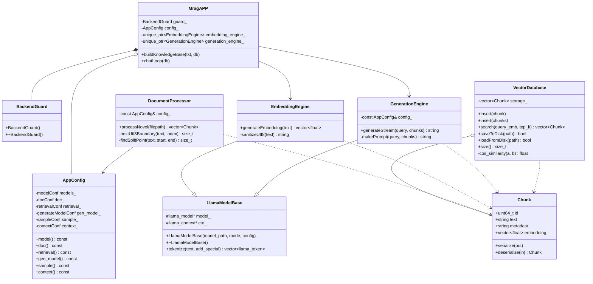

### 设计说明文档
## 1.业务描述与边界
>要解决的问题：基于llama.cpp的C API从零搭建一个本地RAG问答系统
>核心业务流程与边界上下文：
系统内：txt文档解析、文本切分、嵌入向量、检索向量、生成回答
系统外：模型训练（直接用GGUF模型）
## 2.识别核心领域对象
>对象名 | 类型 | 职责 |
Chunk | 实体 | 表示一个文本块，其中包含ID、文本内容、章节标签、向量嵌入
DocumentProcessor | 读取txt文件，切分为Chunk列表
VectorDatabase | 存储Chunk，支持插入、检索等功能
EmbeddingEngine | 将文本转换为浮点向量
GenerationEngine | 基于检索结果生成回答
LlamaModelBase | 基类 | 封装llama.cpp模型与上下文，提供RAII管理
AppConfig | 值对象 | 存储配置参数
MragAPP | 协调建库和问答流程
## 3.类图

## 4.已知局限性
1. 目前系统不能支持多个txt文件同时处理
2. 目前系统还不支持配置文件热加载
3. 在考虑滑动窗口切分的时候只考虑了最常见的。！？，四种标点，虽然避免了在遇到《》和用到：、“”的短句里切分导致语义不完整的问题，都是如果遇到长篇对话可能还是会将完整的语义切碎
4. 现在根据文档要求在每次调用VectorDataBase的search函数时都会重新遍历storage_里的每一个chunk并计算余弦相似度，虽然对于目前的数据量来说这种方法没问题，但如果未来想让数据库变大可能会降低搜索速度